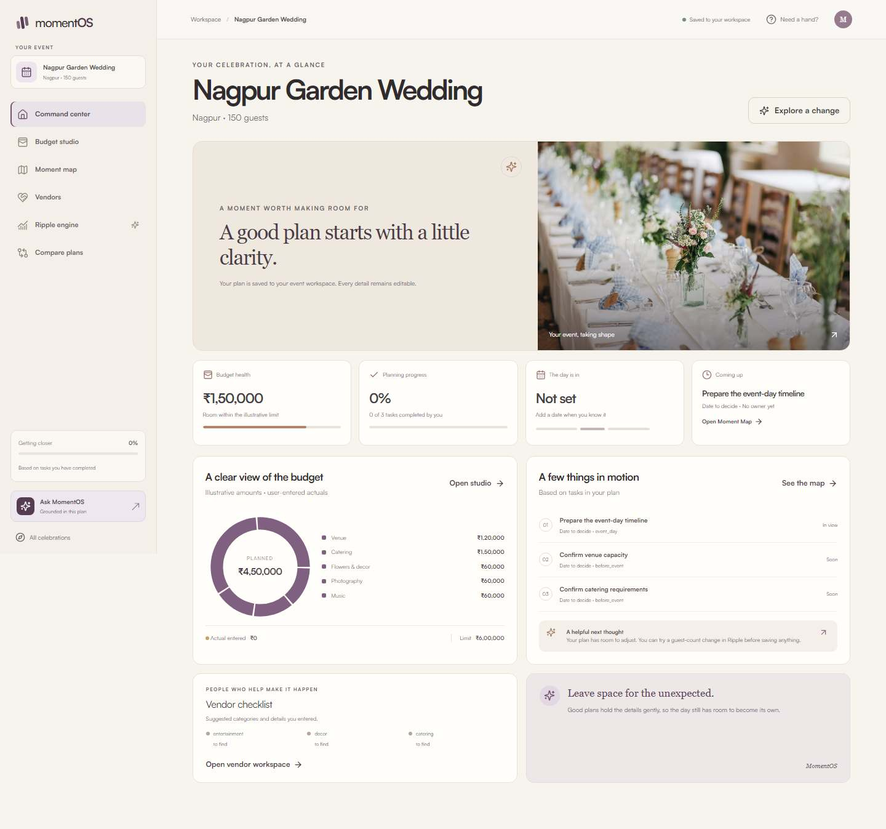
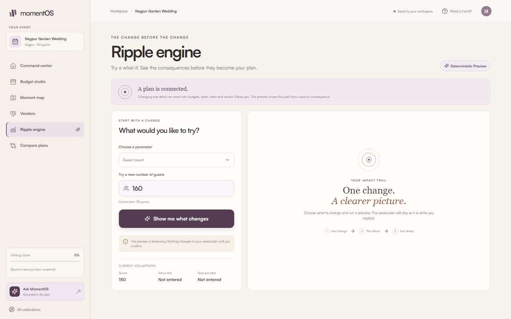
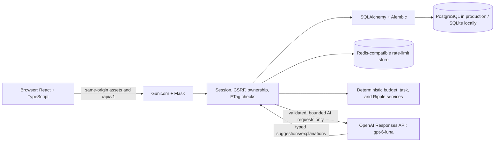

# MomentOS

### The AI Operating System for Every Celebration

MomentOS turns a wedding, birthday, or community-event idea into an editable plan with a budget, timeline, vendor checklist, and personalized guidance. Its signature Ripple Engine makes the consequences of a change visible before anyone saves it.

**PromptWars Challenge 5 — Celebration & Event Planner** · Hack2Skill PromptWars Virtual

> **Release status:** the production configuration and submission materials are prepared. The app is not yet publicly deployed, and no public repository has been created. Links will be added after those steps are authorized and verified.

## Why MomentOS

Event plans are full of connected decisions. Adding guests can change catering costs, table counts, invitations, vendor workload, venue capacity, and the overall budget. MomentOS brings those dependencies into one workspace so organizers can make informed changes before committing them.

## Product highlights

- **AI Event Architect** — interprets a natural-language brief and creates a structured, reviewable blueprint.
- **Event Command Center** — tracks the saved plan, budget health, milestones, tasks, and planning alerts.
- **Budget Studio** — organizes estimates and editable line items, including illustrative per-guest assumptions.
- **Ripple Engine** — calculates before/after financial and dependency effects deterministically; previews require explicit confirmation.
- **Moment Map** — provides an editable milestone and task timeline with dependencies.
- **Vendor Workspace** — tracks user-entered contacts, quotations, and selection status without claiming real availability.
- **AI Copilot** — answers event-specific questions using a minimal, authorized event context.
- **Scenario Comparison** — compares guest-count and planning alternatives.

All example prices and vendor details are assumptions for planning, not market quotations or availability checks.

## Screenshots

These captures come from the local browser audit. The tested workflow used a schema-valid mocked AI provider; the captures are visual evidence and do not represent a live provider session.

**Landing page and event workspace**




**Ripple Engine preview**



## How the AI and Ripple Engine work

The Flask backend calls **GPT-6 Luna** through the OpenAI Responses API for structured event interpretation, blueprint generation, personalized ideas, task/vendor suggestions, Ripple explanations, and contextual Copilot answers. Pydantic schemas validate provider output before use.

Python remains authoritative for money and operational constraints. It performs budget arithmetic, per-guest recalculation, capacity checks, task/dependency validation, and Ripple simulations. A preview does not save changes; the user explicitly confirms a version-checked transaction.

The frontend never calls OpenAI and never contains the API credential. Demo mode is explicit and deterministic; a live provider failure never silently changes to demo data or another model.

## Architecture



## Technology

- **Frontend:** React 19, TypeScript, Vite, Tailwind CSS, Recharts, Motion, Playwright, Vitest, axe-core.
- **Backend:** Python 3.12, Flask, SQLAlchemy, Alembic, Pydantic, Flask-Limiter, Gunicorn.
- **Data:** SQLite for local development; PostgreSQL for production. Shared Redis-compatible storage is configured for production rate limits.
- **AI:** official OpenAI Python SDK and Responses API; fixed model ID `gpt-6-luna`.

## Run locally

Requirements: Python 3.11+ (the deployment image uses 3.12), Node.js 22+, and npm.

From the project root in PowerShell:

```powershell
Copy-Item .env.example .env
python -m venv .venv
.\.venv\Scripts\Activate.ps1
python -m pip install -r backend\requirements.txt
$env:FLASK_SKIP_DOTENV = '1'
$env:FLASK_APP = 'backend.wsgi:app'
$env:APP_ENV = 'development'
$env:AI_MODE = 'demo'
python -m flask db upgrade
python -m flask run --host 127.0.0.1 --port 5000
```

In a second terminal:

```powershell
Set-Location frontend
npm ci
npm run dev
```

Open the Vite URL shown in the terminal. The frontend proxies `/api` to Flask. The copied `.env` is private and ignored by Git. The safe template starts with `AI_MODE=demo`; live AI requires an authorized key stored only in the backend environment and `OPENAI_MODEL=gpt-6-luna`.

## Test and build

From the repository root:

```powershell
& 'G:\conda_envs\py311\python.exe' -B -m pytest -p no:cacheprovider backend/tests -q
```

From `frontend/`:

```powershell
npm run typecheck
npm run lint
npm test -- --run
npm run build
npm run test:e2e
npm run test:e2e:live-mock
```

On Windows, point Playwright at the Python runtime and browser cache if app-execution aliases are not enabled:

```powershell
$env:MOMENTOS_PYTHON = 'G:\conda_envs\py311\python.exe'
$env:PLAYWRIGHT_BROWSERS_PATH = 'G:\DevData\playwright-browsers'
```

The live-mock Playwright suite uses real React-to-Flask HTTP, sessions, CSRF, and an isolated SQLite database, with a valid mocked AI provider. It is not evidence of a live-browser OpenAI request. Previous verified counts and limits are in `docs/07_dom_verification.md`.

## Production deployment

The recommended prepared target is Render: a same-origin Docker web service, persistent PostgreSQL, and shared Redis-compatible rate-limit storage. The provider costs money for an always-on production setup; the current low-tier estimate and free-tier limitations are in [`docs/08_deployment_guide.md`](docs/08_deployment_guide.md). No service has been created or deployed.

```sh
docker build -t momentos:local .
```

The Render Blueprint is [`render.yaml`](render.yaml). It requests `OPENAI_API_KEY`, `APP_BASE_URL`, and `TRUSTED_ORIGINS` through the provider's secret/configuration UI, generates `SECRET_KEY`, binds PostgreSQL and Redis by service references, applies Alembic migrations before deploy, and uses the Flask readiness endpoint. Confirm all costs and the forwarded-proxy chain before importing it.

## Security notes

- Never commit `.env`, database credentials, or private keys. `.env.example` contains safe placeholders only.
- Keep OpenAI credentials in a server-side secret manager. No key is passed to Vite or included in the frontend bundle.
- Production startup rejects demo AI, missing credentials, SQLite, insecure origins/cookies, in-memory rate limits, and unspecified proxy trust counts.
- Cookie-backed sessions are isolated by server-side ownership checks; state changes require CSRF and trusted-origin validation.
- AI context and outputs are bounded and validated. No model can write to the database directly.

## Current limitations

- Not yet deployed. No public app URL or public GitHub URL exists.
- PostgreSQL has not been run through the app's migrations/persistence tests. A local PostgreSQL Windows service is present, but its data was not assumed disposable; the Docker daemon was unavailable for an isolated container.
- Real production TLS/reverse-proxy behavior, shared rate-limit operation, and restart persistence remain unverified.
- The browser suite mocks AI provider responses. Stage 06 verified a real GPT-6 Luna blueprint, save, and reload, but a full live-browser plan-to-Copilot flow has not been run.
- Demo video, LinkedIn announcement, and competition submission are drafts only; they have not been published or submitted.

## Credits

Prepared for Hack2Skill PromptWars Virtual, Challenge 5. Uses the OpenAI GPT-6 Luna model through the OpenAI API, React, Vite, Flask, SQLAlchemy, Pydantic, Alembic, and open-source charting/accessibility/testing libraries. Product naming, interface, deterministic planning rules, and illustrative demo content are MomentOS project work.
