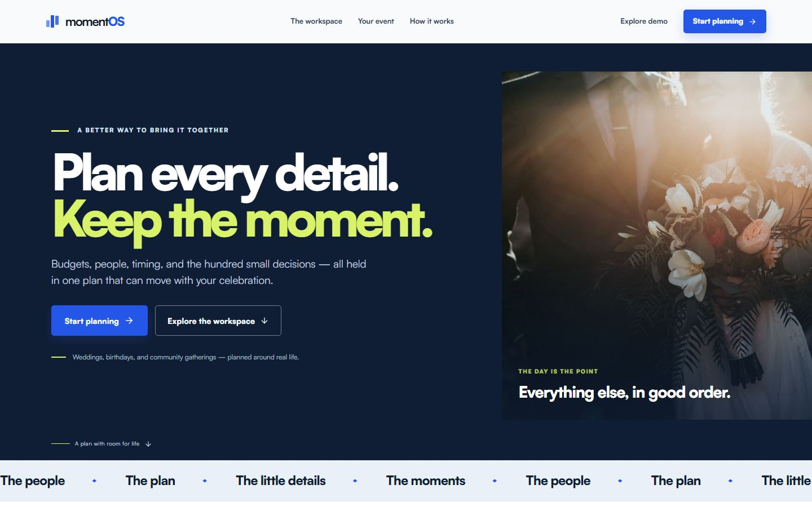
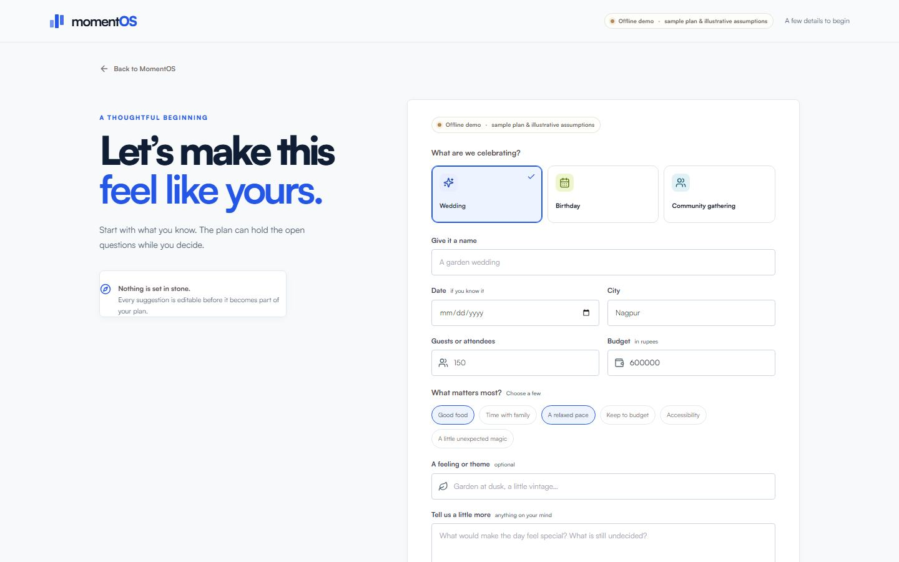
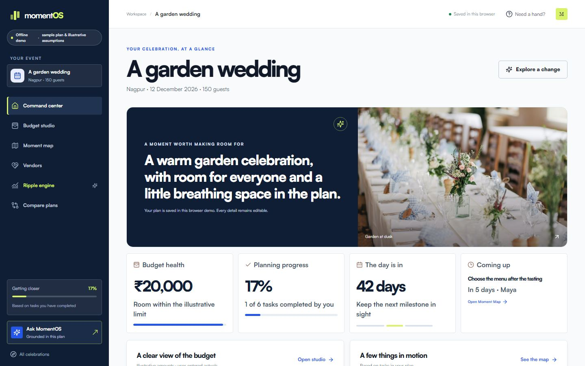
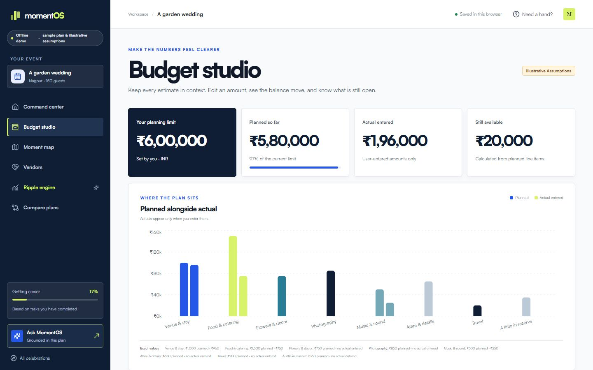
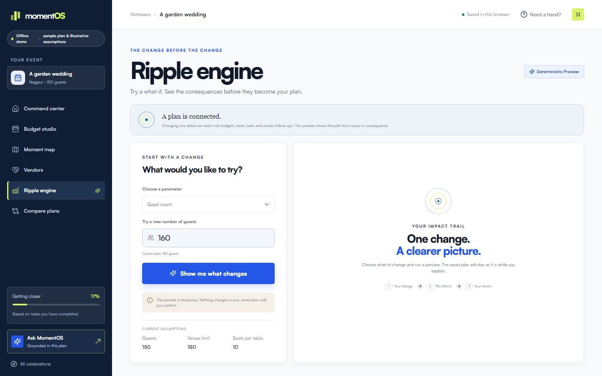
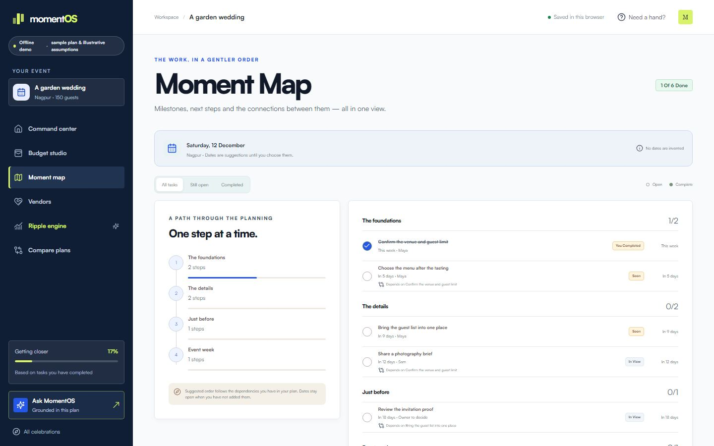
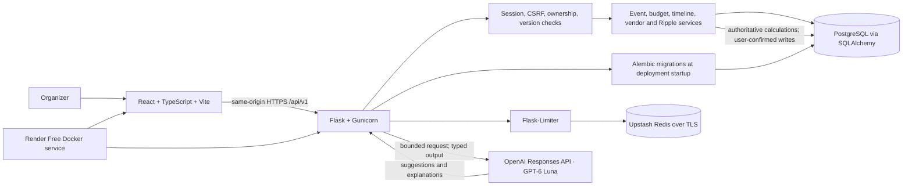

# MomentOS

### Plan the moment. Understand every change.

MomentOS is an AI-powered planning workspace for weddings, birthdays, and community events. It turns an event brief into an editable plan, budget, timeline, and vendor checklist—and shows the consequences of a change before you commit it.

**[Open the live application](https://momentos-event-planner-free.onrender.com)** · [Source repository](https://github.com/CodeWithShrey-collab/MomentOS-Event-Planner) · **Hack2Skill PromptWars Virtual — Challenge 5: Celebration & Event Planner**

    

> **Live deployment:** The public Render Free application is available at the link above. It is configured as a same-origin Flask + React service with Neon PostgreSQL and Upstash Redis. On 2026-10-31, `/api/v1/health/ready` reported the database and rate-limit store ready and AI configured. Render Free can sleep when idle, so the first request may take longer. This point-in-time check is not an uptime guarantee or an end-to-end live AI workflow test.

## The planning problem

An event is a network of decisions. A guest-count change can affect catering, seating, invitations, venue capacity, vendor requirements, the timeline, and the total budget. When those details live in separate documents, organizers have to reconcile them by hand—and can miss a cost or dependency before it becomes urgent.

## The MomentOS approach

MomentOS brings the plan into one connected workspace. GPT-6 Luna interprets the brief and helps generate personalized planning ideas. Deterministic Python services calculate financial and operational consequences. The organizer reviews the result and confirms changes explicitly; AI suggestions cannot silently rewrite the saved plan.

## Explore the workspace

| Module | What it does |
| --- | --- |
| **AI Event Architect** | Interprets an event brief, creates a structured blueprint for review, and surfaces missing details. |
| **Event Command Center** | Brings event details, budget health, milestones, tasks, and planning status together. |
| **Budget Studio** | Shows planned and user-entered amounts by category, editable allocations, and remaining funds. Illustrative assumptions are identified. |
| **Ripple Engine** | Previews how supported changes affect costs, capacity, tasks, vendors, and budget constraints. The backend calculates the numbers; the preview is not saved until confirmed. |
| **Moment Map** | Organizes milestones, due dates, tasks, and dependencies into an editable timeline. |
| **Vendor Workspace** | Tracks vendor categories, contact details, selection status, and user-entered estimates or quotations. It does not verify availability. |
| **AI Copilot** | Answers event-specific questions using a minimal, server-authorized subset of saved event context. |
| **Scenario Comparison** | Compares a small set of alternative planning assumptions and their deterministic outcomes. |

### Ripple Engine: understand what a change touches

Suppose a wedding plan changes from 150 to 200 guests. Ripple Engine builds a non-mutating preview from the event's current state and configurable cost assumptions. Depending on the plan, the preview can show per-guest expense changes, seating and invitation implications, venue-capacity warnings, affected budget categories, and related task or vendor adjustments. It reports budget constraints and before/after differences from Python calculations; GPT-6 Luna can explain those results, but it cannot replace them. The organizer can cancel the preview or explicitly confirm it. Confirmation checks the event version and commits transactionally to prevent stale changes from silently overwriting newer work.

No fixed cost result is shown here because the outcome depends on the event's saved assumptions.

## Screenshots

These screenshots were captured from the local application using clearly labeled illustrative demo fixtures. They show the current repository's **Modern Editorial Studio** frontend and are not evidence of live AI output or production data. The deployed UI may lag this local visual revision until it is published and redeployed.

| Landing | Event Architect |
| --- | --- |
|  |  |

| Command Center | Budget Studio |
| --- | --- |
|  |  |

| Ripple Engine | Moment Map |
| --- | --- |
|  |  |

## How it works

1. Describe the celebration and its constraints.
2. Ask the AI Event Architect to interpret the brief and draft a structured plan.
3. Review the blueprint, assumptions, and missing details before saving.
4. Work from the saved dashboard, budget, timeline, and vendor views.
5. Preview a supported change in Ripple Engine and inspect its consequences.
6. Confirm or cancel. Confirmed changes are version-checked and persisted.
7. Continue refining the plan with the workspace and event-aware Copilot.

## Architecture



The model has no database tools and does not perform authoritative currency arithmetic. The backend validates AI output and owns persistence. React assets are built into the Docker image and served by Flask on the same origin as the API.

## AI integration

The Flask backend uses the official OpenAI Python SDK and Responses API with the fixed model ID **`gpt-6-luna`**. Typed operations cover requirement extraction, blueprint generation, personalized ideas, task suggestions, vendor-category suggestions, Ripple explanations, and contextual Copilot answers. Responses are validated against Pydantic schemas before application use; refusals and incomplete outputs are handled as provider errors. The app does not silently fall back to another model or to demo data after a live failure.

AI requests have bounded context, output budgets, and timeouts. The configured defaults are low reasoning effort, a 3,000-token output cap, 20 AI requests per session per day, and 5 per minute. Actual production overrides and OpenAI charges depend on service configuration and usage. Request records retain usage metadata without storing private prompt content.

**AI provides interpretation and recommendations. Deterministic Python services remain authoritative for financial calculations, constraints, and state changes.**

Stage 06 recorded one successful live GPT-6 Luna blueprint request, explicit save, and reload in an isolated application check. Browser workflows use a schema-valid mocked provider; they do not demonstrate live OpenAI calls in the browser. A complete live production journey through AI generation and Copilot has not been verified end to end.

## Technology

| Area | Technologies |
| --- | --- |
| Frontend | React 19, TypeScript 5.9, Vite 7, Tailwind CSS 3, Recharts 3, Motion 12 |
| Backend | Python 3.12 in Docker, Flask 3, SQLAlchemy 2, Alembic 1.20, Pydantic 2, Gunicorn 21 |
| AI | OpenAI Python SDK 3, Responses API, GPT-6 Luna, Structured Outputs |
| Database | PostgreSQL in production; SQLite for local development and isolated tests; psycopg 3 |
| Shared rate limiting | Flask-Limiter 3, Redis protocol over TLS, Upstash Redis |
| Hosting | Render Free Docker web service; Neon PostgreSQL |
| Quality | Pytest, Vitest 3, Playwright 1, axe-core Playwright, TypeScript, ESLint |

Pinned backend versions are in [`backend/requirements.txt`](backend/requirements.txt); frontend versions and scripts are in [`frontend/package.json`](frontend/package.json) and [`frontend/package-lock.json`](frontend/package-lock.json).

## Run locally

### Prerequisites

- Python 3.11 or later (the production Docker image uses Python 3.12)
- Node.js 22 and npm
- Git

### Clone and configure

```powershell
git clone https://github.com/CodeWithShrey-collab/MomentOS-Event-Planner.git
Set-Location MomentOS-Event-Planner
Copy-Item .env.example .env
```

The safe `.env.example` selects deterministic demo mode. You can run the local app without an OpenAI key. For live AI, put your own key only in the private root `.env` and set `AI_MODE=live`; keep `OPENAI_MODEL=gpt-6-luna`. Never put secrets in frontend variables or commit `.env`.

### Install backend and migrate

```powershell
python -m venv .venv
.\.venv\Scripts\Activate.ps1
python -m pip install -r backend\requirements.txt
$env:FLASK_SKIP_DOTENV = '1'
$env:FLASK_APP = 'backend.wsgi:app'
$env:APP_ENV = 'development'
$env:AI_MODE = 'demo'
python -m flask db upgrade
```

### Start Flask and Vite

In the first terminal, start the API:

```powershell
python -m flask run --host 127.0.0.1 --port 5000
```

In a second terminal from the repository root:

```powershell
Set-Location frontend
npm ci
npm run dev
```

Open the Vite URL printed in the terminal. Vite proxies `/api` requests to the local Flask server. For Bash shells, activate with `source .venv/bin/activate`; use the same Python, Flask migration, and npm commands with forward-slash paths.

## Environment configuration

Start with [`.env.example`](.env.example). Common variables are:

| Variable | Purpose |
| --- | --- |
| `APP_ENV` | Runtime mode: development or production. |
| `AI_MODE` | `demo` for offline deterministic fixtures; `live` for backend provider requests. |
| `OPENAI_API_KEY` | Private backend-only OpenAI credential; not required in demo mode. |
| `OPENAI_MODEL` | Must remain `gpt-6-luna`; automatic model fallback is disabled. |
| `OPENAI_REASONING_EFFORT` | Defaults to `low`; blueprint generation can use the configured planning effort. |
| `DATABASE_URL` | Local SQLite or production PostgreSQL URL. Production requires PostgreSQL with TLS. |
| `RATE_LIMIT_STORAGE_URI` | Local `memory://` for development; production requires an Upstash Redis TCP/TLS `rediss://` URL. |
| `SECRET_KEY` | Required in production to sign session cookies. |
| `APP_BASE_URL`, `TRUSTED_ORIGINS` | Exact HTTPS production origin configuration. |

See the free deployment guide for the complete production variable set and strict validation rules.

## Tests and quality checks

From the repository root:

```powershell
python -m pytest backend/tests -q
```

From `frontend/`:

```powershell
npm run typecheck
npm run lint
npm test
npm run build
npm run test:e2e
npm run test:e2e:live-mock
```

The latest local verification recorded on 2026-10-31: **Pytest 100 passed; Vitest 10 passed; typecheck, lint, and production build passed; demo Playwright 1 passed; Flask-backed mocked-provider Playwright 3 passed.** The responsive sweep covered 36 screen/viewport combinations and 18 axe scans with zero reported violations. The Flask-backed browser suite uses real React-to-Flask HTTP, cookies, CSRF, and an isolated database, but mocks the AI provider; it is not a live OpenAI browser test. See [`docs/06_integration_verification.md`](docs/06_integration_verification.md) and [`docs/07_dom_verification.md`](docs/07_dom_verification.md). These are point-in-time results, not a CI badge or a claim about every future change.

## Deployment

The public application URL is **[momentos-event-planner-free.onrender.com](https://momentos-event-planner-free.onrender.com)**. The configured deployment is one Render Free Docker web service. The image builds the React frontend and serves it with Flask/Gunicorn from the same origin; production data uses Neon PostgreSQL, rate limits use Upstash Redis over TLS, and live AI requests use the backend-only GPT-6 Luna integration.

Free Render services can sleep after inactivity and use ephemeral local storage; event data belongs in PostgreSQL. Neon may also autosuspend. These behaviors can introduce cold-start delays. OpenAI usage is billed separately from hosting. The deployment configuration is [`render-free.yaml`](render-free.yaml); the default [`render.yaml`](render.yaml) is a separate paid blueprint and must not be imported for this free setup. See the [free deployment guide](docs/08_free_deployment_guide.md) and [deployment checklist](docs/08_free_deployment_checklist.md) for service configuration, migration startup, health checks, and limitations.

On 2026-10-31, the deployed readiness endpoint reported PostgreSQL, Redis, and live-AI configuration ready. Stage 06 verified one real GPT-6 Luna blueprint → save → reload path in an isolated application check. A complete live production AI journey through blueprint generation and Copilot has not been verified; no uptime or production SLA is claimed.

## Security

- OpenAI credentials stay in the Flask environment and are never sent to the browser.
- Production configuration requires live GPT-6 Luna, PostgreSQL, HTTPS origins and secure HttpOnly cookies, CSRF/origin validation, and shared Redis rate limiting.
- Flask checks event ownership server-side. State-changing requests use CSRF protection, ETags/version checks, and idempotency keys where applicable.
- Production disables trust in forwarded `X-Forwarded-*` headers; Render rate limiting uses the configured Render/Cloudflare client-IP source.
- AI context and output are bounded and validated. User/vendor text is treated as untrusted; the model has no direct database or SQL execution capability.
- Production startup validates required settings and dependencies, then applies Alembic migrations before starting Gunicorn.

These are implementation controls, not a security certification. Do not commit `.env`, database URLs, keys, or local database files.

## Limitations and roadmap

Planning prices and vendor entries are editable illustrative assumptions, not verified market quotations or availability. Real vendor discovery, availability, and booking integrations are not implemented. Live AI/browser and every external production dependency are not fully verified end to end. Free-tier limits and service behavior can change; check provider dashboards.

Potential future work—not current functionality—includes calendar integrations, verified vendor-data providers, collaborative planning, and scheduled notifications.

## Competition and credits

Built for **Hack2Skill PromptWars Virtual — Challenge 5: Celebration & Event Planner**. Framework and service credits: React, Vite, TypeScript, Flask, SQLAlchemy, Alembic, Pydantic, PostgreSQL, Redis, OpenAI, Render, Neon, and Upstash. No competition ranking or award is claimed.
